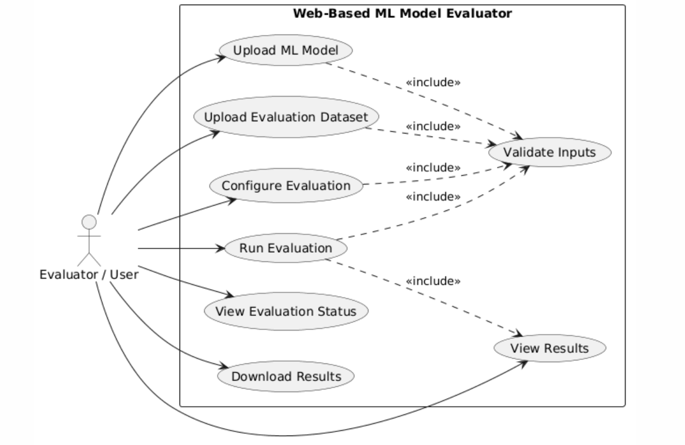

# Software Requirements Specification (SRS)
## Web-Based ML Model Evaluator

> **Deviations (as built).** Every requirement here is met; where the build made a choice the SRS left open or added to it, the deviation is recorded in the [Deviation Log](../docs/Deviation_Log.md): authentication as an optional API key (NFR-07, SEC-06: [D-05](../docs/Deviation_Log.md#1-design-deviations)), results kept in memory for the session (FR-18: D-08), JSON download (FR-15: D-09), binary class labels other than 0/1 (FR-10: D-10), the accepted CSV format (FR-04: D-12), and plain-language metric explanations (NFR-01: D-15).

## Document Control

| | |
|---|---|
| **Document** | Software Requirements Specification (SRS) |
| **Project** | Web-Based ML Model Evaluator (Software Engineering mini-project) |
| **Version** | 1.3 (as built) |
| **Date** | 17 November 2026 |
| **Authors** | Akshya Sivagami (first version), Adyanth Mallur (revisions) |
| **Team** | Adyanth Mallur, Akash MP, Akshath Patil, Akshya Sivagami |
| **Structure follows** | IEEE Std 830-1998, Recommended Practice for Software Requirements Specifications |
| **Repository path** | `deliverable-1/01_SRS.md` |
| **Related documents** | [Test Plan](02_Test_Plan.md), [Architecture and Design](03_Architecture_and_Design.md), [Product Backlog](../planning/Product_Backlog.md), [Deviation Log](../docs/Deviation_Log.md) |

## Revision History

| Rev | Date | Author | What changed | Commits |
|---|---|---|---|---|
| 1.0 | 26 Sep 2026 | Akshya | First version: introduction, overall description, FR-01 to FR-18, NFR-01 to NFR-10, security objectives SO-01 to SO-03 and requirements SEC-01 to SEC-08, use cases UC-01 to UC-03 and the use case diagram | `0d9a260` (renamed to `.md` in `4abe8a3`) |
| 1.1 | 27 Sep 2026 | Adyanth | Review for Deliverable 1: acronyms defined and the user role named (Evaluator/User); a table mapping the diagram's use cases to UC-01 to UC-03; FR-19 and FR-20 added (unknown evaluation ID, download before completion) | `6ac2319`, `13a9944` |
| 1.2 | 11 Nov 2026 | Adyanth | As-built note linking the Deviation Log; final audit fixes | `ce6f40e`, `9f5ecf4` |
| 1.3 | 17 Nov 2026 | Adyanth | Document control, this revision history, 1.4 References and 1.5 Document Overview | this revision |

The requirements themselves are unchanged since revision 1.1: every FR, NFR and SEC requirement is met (see the [System Validation Report](../docs/System_Validation_Report.md)).

## 1. Introduction

### 1.1 Purpose

This Software Requirements Specification defines the functional, non-functional, security, and interface requirements for the Web-Based ML Model Evaluator.

The system provides a browser-based interface through which a user can submit a supported machine-learning model and evaluation dataset, configure evaluation parameters, execute the evaluation, and inspect standardized results.

### 1.2 Scope

The system is an evaluation platform for already-trained supervised machine-learning models. It supports:

- model and dataset upload;
- input validation;
- selection/configuration of the target column;
- classification and regression evaluation;
- calculation and presentation of relevant evaluation metrics;
- validation and error reporting;
- downloadable evaluation results;
- basic security controls for uploaded files and evaluation requests.

The system does not train models, perform automated model selection, or make a production-readiness decision on behalf of the user.

### 1.3 Definitions and Acronyms

| Term | Meaning |
|---|---|
| ML | Machine Learning |
| Model | Previously trained machine-learning model submitted for evaluation |
| Dataset | Evaluation data supplied by the user |
| Target | Dataset column containing the expected output |
| Evaluator | Web application described by this SRS |
| Evaluator/User | Person who submits a model and dataset for evaluation; the primary actor (see Section 2.3) |
| Metric | Quantitative measure used to assess model performance |
| FR | Functional Requirement |
| NFR | Non-Functional Requirement |
| SO | Security Objective |
| SEC | Security Requirement |
| UC | Use Case |
| API | Application Programming Interface |
| UI | User Interface |
| CSV | Comma-Separated Values file |
| MAE, MSE, RMSE | Mean Absolute Error, Mean Squared Error, Root Mean Squared Error |
| R² | Coefficient of determination |

### 1.4 References

- IEEE Std 830-1998, *IEEE Recommended Practice for Software Requirements Specifications* (the structure of this document).
- [Software Test Plan](02_Test_Plan.md): how each requirement here is verified (traceability matrix, section 7).
- [Software Architecture & Design Specification](03_Architecture_and_Design.md): how the requirements are realised; the API is in section 10 and the errors in section 11.
- [Product Backlog](../planning/Product_Backlog.md): every FR and NFR mapped to backlog items and test cases.
- [Deviation Log](../docs/Deviation_Log.md): where what was built differs from this document.

### 1.5 Document Overview

Section 2 describes the product in general terms: its perspective, functions, users, environment, constraints and assumptions. Section 3 holds the specific requirements: functional requirements (3.1, `FR-`), non-functional requirements with a measurable acceptance criterion each (3.2, `NFR-`) and the external interfaces (3.3). Section 4 states the security objectives (`SO-`) and security requirements (`SEC-`). Section 5 gives the use cases (`UC-`) and the use case diagram.

Requirement identifiers are stable. The Test Plan, the Architecture document, the Product Backlog and the automated tests all refer to them.

---

## 2. Overall Description

### 2.1 Product Perspective

The evaluator is a web-based application composed of a browser-facing frontend, a backend evaluation service, validation components, and a temporary/persistent results store.

High-level flow:

**User → Web UI → Backend/API → Validation → Evaluation Engine → Results → Web UI**

### 2.2 Product Functions

The system shall provide:

1. Model upload.
2. Dataset upload.
3. Input validation.
4. Evaluation configuration.
5. Model execution against evaluation data.
6. Metric calculation.
7. Result visualization.
8. Result export/download.
9. Clear error reporting.
10. Security validation for uploaded files and evaluation requests.

### 2.3 User Classes

**Evaluator/User:** A student, developer, researcher, or ML practitioner who has a trained model and wants to assess its performance on an evaluation dataset.

**Administrator/Operator:** A project maintainer responsible for application configuration and operational monitoring. Administrator functions are outside the primary user workflow for this mini-project.

### 2.4 Operating Environment

The system shall be accessible through a modern web browser. The server side shall provide a runtime capable of executing the supported ML model format and evaluation libraries.

### 2.5 Constraints

- The system shall evaluate only supported model and dataset formats.
- Evaluation resources are limited by the deployment environment.
- Uploaded artifacts shall not be treated as trusted input.
- Metric availability depends on the selected task type and available prediction outputs.

### 2.6 Assumptions and Dependencies

- Users provide valid, previously trained models.
- Users provide a dataset containing the required target column.
- Required ML libraries are available in the server environment.
- The deployment environment provides sufficient CPU, memory, and temporary storage for the configured evaluation limits.

---

## 3. Specific Requirements

### 3.1 Functional Requirements

Requirements are written to be clear, unambiguous, concise, testable, and measurable.

| ID | Requirement |
|---|---|
| FR-01 | The system shall allow a user to upload one supported ML model file. |
| FR-02 | The system shall allow a user to upload one CSV evaluation dataset. |
| FR-03 | The system shall validate file type and configured file-size limits before evaluation. |
| FR-04 | The system shall display a clear validation error when an uploaded artifact is unsupported, malformed, or exceeds the configured limit. |
| FR-05 | The system shall allow the user to select the dataset target column before evaluation. |
| FR-06 | The system shall allow the user to select the evaluation task type from the supported classification and regression options. |
| FR-07 | The system shall verify that the selected target column exists in the uploaded dataset before evaluation starts. |
| FR-08 | The system shall execute the selected model on the evaluation dataset using the configured evaluation parameters. |
| FR-09 | The system shall calculate task-appropriate evaluation metrics from the model predictions and expected target values. |
| FR-10 | For classification evaluation, the system shall report accuracy and shall report precision, recall, and F1-score when they are applicable to the selected classification configuration. |
| FR-11 | For regression evaluation, the system shall report MAE, MSE, RMSE, and R². |
| FR-12 | The system shall display the evaluation status as pending, running, completed, or failed. |
| FR-13 | The system shall display evaluation results in a readable tabular and/or visual form. |
| FR-14 | The system shall display an explicit error message when evaluation cannot be completed. |
| FR-15 | The system shall allow the user to download completed evaluation results in a structured format. |
| FR-16 | The system shall prevent evaluation from starting when mandatory inputs are missing or invalid. |
| FR-17 | The system shall isolate uploaded artifacts from the application source/configuration files and shall use temporary storage for evaluation inputs where persistent storage is not required. |
| FR-18 | The system shall record an evaluation identifier and basic evaluation metadata sufficient to associate a result with its submitted inputs during the active evaluation session. |
| FR-19 | The system shall return a not-found error when a status, result, or download request references an unknown evaluation identifier. |
| FR-20 | The system shall reject a result download request for an evaluation that has not reached the completed status. |

### 3.2 Non-Functional Requirements

| ID | Requirement | Measurement/Acceptance Criterion |
|---|---|---|
| NFR-01 | The system shall provide a usable web interface for the primary evaluation workflow. | A new user shall be able to identify upload, configuration, run, and result areas without external instructions during usability testing. |
| NFR-02 | For a valid evaluation within configured resource limits, the API shall acknowledge the evaluation request within 2 seconds under normal local deployment conditions. | Measured from request receipt to response acknowledgement over 10 test runs. |
| NFR-03 | The system shall provide deterministic metric calculations for identical model, dataset, task, and configuration inputs. | Repeated evaluation of the same inputs shall produce identical metric values, subject to documented model nondeterminism. |
| NFR-04 | The system shall reject unsupported file types before model execution. | 100% of unsupported-file test cases shall be rejected before evaluation. |
| NFR-05 | The system shall return user-readable validation errors rather than exposing internal stack traces. | 100% of tested validation failures shall return a defined error response without server implementation details. |
| NFR-06 | The system shall enforce configured upload size limits. | Files exceeding the configured limit shall be rejected before evaluation. |
| NFR-07 | The system shall protect evaluation endpoints against unauthenticated access if authentication is enabled by the deployment configuration. | Protected endpoints shall reject requests without valid authentication credentials. |
| NFR-08 | The system shall maintain traceable evaluation status. | Every submitted evaluation shall have one evaluation identifier and a terminal status of completed or failed. |
| NFR-09 | The system shall support maintainable modular separation between UI, API, validation, evaluation, and result handling. | Architecture review shall identify separate components/interfaces for these responsibilities. |
| NFR-10 | The system shall provide security validation for uploaded files and model execution inputs. | Security test cases shall cover file validation, path handling, oversized input, and malformed input. |

### 3.3 External Interface Requirements

#### 3.3.1 User Interface

The UI shall contain:

- model upload control;
- dataset upload control;
- task-type selection;
- target-column selection;
- evaluation/run control;
- status indicator;
- results panel;
- error/validation messages;
- result download control.

#### 3.3.2 API Interface

The backend shall expose an API for:

- uploading/validating evaluation artifacts;
- creating an evaluation request;
- querying evaluation status/results;
- downloading completed results.

The detailed API contract is specified in the [Architecture & Design Specification](03_Architecture_and_Design.md#10-api-design).

---

## 4. Security Requirements

### 4.1 Security Objectives

**SO-01 — Protect application integrity:** Uploaded files and user-controlled metadata shall not be allowed to overwrite application files, configuration, or executable source.

**SO-02 — Protect evaluation resources:** The application shall limit uploaded artifact size and validate inputs before expensive model execution to reduce resource-exhaustion and malformed-input risks.

**SO-03 — Minimize information disclosure:** User-facing errors shall expose actionable validation information without revealing internal stack traces, file-system paths, secrets, or implementation details.

### 4.2 Security Requirements

| ID | Requirement |
|---|---|
| SEC-01 | The system shall validate uploaded file extensions/types and configured size limits before storing or executing artifacts. |
| SEC-02 | The system shall generate server-controlled storage names/paths rather than directly using user-supplied filenames as filesystem paths. |
| SEC-03 | The system shall reject malformed datasets and model artifacts before model execution. |
| SEC-04 | The system shall enforce execution/resource limits for evaluation requests. |
| SEC-05 | The system shall not return raw exception traces, server paths, or secrets in client-facing error responses. |
| SEC-06 | If authentication is enabled, evaluation endpoints and result retrieval shall enforce the configured authentication mechanism. |
| SEC-07 | Temporary uploaded artifacts shall be deleted according to the application's configured retention policy after the evaluation lifecycle ends. |
| SEC-08 | The system shall validate target-column and task-type values against server-side allowed values rather than trusting client-side validation alone. |

---

## 5. Use Cases

### UC-01: Evaluate a Model

**Primary Actor:** Evaluator/User

**Preconditions:**
- The application is reachable.
- The user has a supported model and evaluation dataset.

**Main Flow:**
1. User opens the evaluator.
2. User uploads a model.
3. User uploads an evaluation dataset.
4. System validates both inputs.
5. User selects task type and target column.
6. System validates configuration.
7. User starts evaluation.
8. System creates an evaluation identifier and status.
9. Evaluation engine generates predictions.
10. System calculates appropriate metrics.
11. System stores/returns the evaluation result.
12. UI displays the result.
13. User may download the result.

**Alternative Flows:**
- Invalid file → system rejects the file and displays the reason.
- Missing target → system prevents execution.
- Evaluation failure → system marks the evaluation as failed and displays a safe error message.

### UC-02: Validate Uploaded Inputs

**Primary Actor:** Evaluator/User

1. User submits an artifact.
2. System checks type, size, structure, and required fields.
3. System either accepts the artifact for the next stage or returns a validation error.

### UC-03: Download Evaluation Result

**Primary Actor:** Evaluator/User

1. User opens a completed evaluation.
2. User selects download.
3. System verifies the evaluation exists and is completed.
4. System returns the structured result file.

### Use Case Diagram

*Source: [`uml/use_case.puml`](uml/use_case.puml) (PlantUML)*

The diagram models the workflow at a finer granularity than the textual use cases above. Each diagram use case maps to them as follows:

| Diagram Use Case | Textual Use Case |
|---|---|
| Upload ML Model | UC-01, step 2 |
| Upload Evaluation Dataset | UC-01, step 3 |
| Validate Inputs («include») | UC-02; UC-01, steps 4 and 6 |
| Configure Evaluation | UC-01, step 5 |
| Run Evaluation | UC-01, steps 7–11 |
| View Evaluation Status | UC-01, steps 8–11 (status values per FR-12) |
| View Results | UC-01, step 12 |
| Download Results | UC-03; UC-01, step 13 |

---