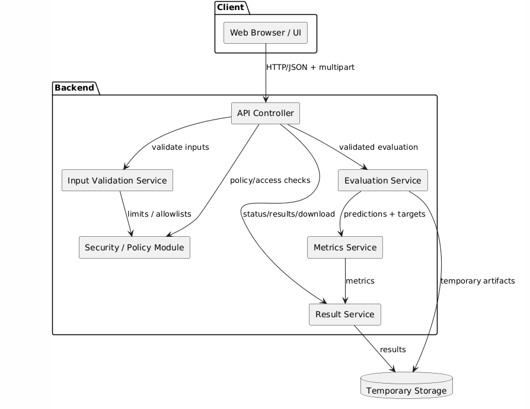
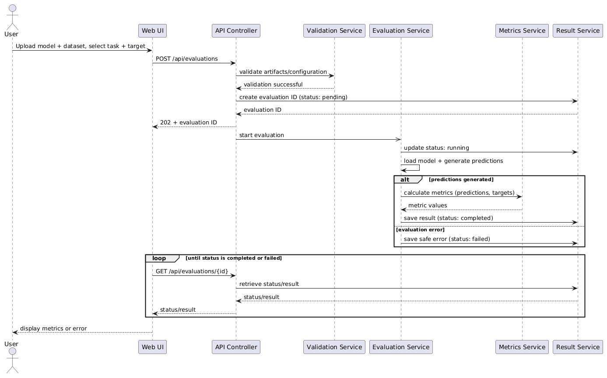
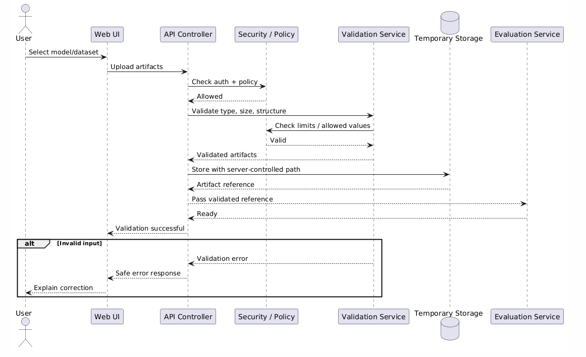

# Software Architecture & Design Specification
## Web-Based ML Model Evaluator

> **Deviations (as built).** The components, the API (section 10) and the error table (section 11) are implemented as specified. The [Deviation Log](../docs/Deviation_Log.md#1-design-deviations) records where the build differs or adds detail: the code layout per component (D-01), the model checked and run in child processes (D-02, D-03, D-07, D-11), three extra error codes outside the workflow (D-04), the optional API key (D-05), retention on a timer (D-06), the in-memory result store (D-08) and the data rules added after testing (D-10, D-12, D-13).


## Document Control

| | |
|---|---|
| **Document** | Software Architecture & Design Specification (SAD) |
| **Project** | Web-Based ML Model Evaluator (Software Engineering mini-project) |
| **Version** | 1.4 (as built) |
| **Date** | 17 November 2026 |
| **Authors** | Akshya Sivagami (first version), Adyanth Mallur (revisions) |
| **Team** | Adyanth Mallur, Akash MP, Akshath Patil, Akshya Sivagami |
| **Structure follows** | IEEE Std 1016, Software Design Descriptions: Part I architecture, Part II detailed design |
| **Repository path** | `deliverable-1/03_Architecture_and_Design.md` |
| **Related documents** | [SRS](01_SRS.md), [Test Plan](02_Test_Plan.md), [Deviation Log](../docs/Deviation_Log.md), [Requirement-to-code traceability](../docs/TRACEABILITY.md) |

## Revision History

| Rev | Date | Author | What changed | Commits |
|---|---|---|---|---|
| 1.0 | 26 Sep 2026 | Akshya | First version: layered architecture, components, security architecture, two sequence diagrams, API design and error handling | `0d9a260` (renamed to `.md` in `4abe8a3`) |
| 1.1 | 27 Sep 2026 | Adyanth | Diagram references fixed and the diagrams embedded; the components the traceability tables cite defined (API Error Handler, Authentication Middleware, Storage Lifecycle Manager); an error status for every case; unguessable evaluation IDs added as a security control; UML modelling errors corrected in three diagrams; the failed-evaluation response specified | `6ac2319`, `92128b9`, `b720624`, `70782c3` |
| 1.2 | 3 Nov 2026 | Adyanth | API documentation: examples use random UUIDs, the download response specified | `d7d0b15` |
| 1.3 | 11 Nov 2026 | Adyanth | As-built note linking the Deviation Log; final audit fixes | `ce6f40e`, `9f5ecf4` |
| 1.4 | 17 Nov 2026 | Adyanth | Document control, this revision history, as-built notes in sections 8 and 9 (the two separate processes), 6.4 Threat Analysis (STRIDE), 15 Risks and Mitigations and 16 Open Issues | this revision |

# Part I — Architecture Specification

## 1. Introduction

### 1.1 Purpose

This document defines the architecture and detailed design of the Web-Based ML Model Evaluator. It translates the requirements in the [SRS](01_SRS.md) into system components, interfaces, interactions, security controls, and error-handling behavior.

### 1.2 Architectural Goals

- Separate presentation, API, validation, evaluation, and result responsibilities.
- Make evaluation behavior testable independently of the UI.
- Prevent invalid input from reaching the evaluation engine.
- Keep security-sensitive operations centralized.
- Maintain traceability to SRS requirements.

---

## 2. System Architecture

The proposed architecture follows a **layered architecture with a service-oriented backend boundary**:

1. Presentation Layer
2. API/Application Layer
3. Validation Service
4. Evaluation Service
5. Metrics/Result Service
6. Temporary Storage

The Security/Policy Module is cross-cutting: the API layer and the services consult it for limits, allowed values, and access checks.

The browser communicates with the backend through HTTP/JSON APIs and multipart upload requests.

### 2.1 Architectural Pattern

**Primary pattern: Layered Architecture**

The layered pattern separates UI, request orchestration, validation, domain evaluation, and storage responsibilities.

**Supporting pattern: Service-oriented backend components**

Validation, evaluation, and result handling are exposed as distinct internal responsibilities behind the API boundary.

---

## 3. Component Description

| Component | Responsibility | Main Requirements |
|---|---|---|
| Web UI | Uploads, configuration, status, results, download controls | FR-01–FR-06, FR-12–FR-16, NFR-01 |
| API Controller | Receives requests, validates request structure, routes operations | FR-03–FR-08, SEC-08 |
| API Error Handler *(part of API Controller)* | Converts validation and runtime failures into the safe error format of Section 10.4 | FR-04, FR-14, NFR-05, SEC-05 |
| Authentication Middleware *(part of API Controller)* | Enforces the configured authentication mechanism on evaluation and result endpoints when enabled | NFR-07, SEC-06 |
| Input Validation Service | File, schema, size, task, and target validation | FR-03–FR-07, FR-16, SEC-01, SEC-03, SEC-08 |
| Evaluation Service | Loads supported model, prepares input, runs prediction | FR-08, FR-12, SEC-04 |
| Metrics Service | Computes classification/regression metrics | FR-09–FR-11, NFR-03 |
| Result Service | Formats, stores, retrieves, and exports results | FR-13, FR-15, FR-18–FR-20, NFR-08 |
| Temporary Storage | Stores uploaded artifacts/results for the active lifecycle | FR-17, SEC-02, SEC-07 |
| Storage Lifecycle Manager *(part of Temporary Storage)* | Deletes temporary artifacts according to the configured retention policy | SEC-07 |
| Security/Policy Module | Centralizes limits, allowed values, and access checks | NFR-04, NFR-06, NFR-07, SEC-01–SEC-08 |

The API Error Handler, Authentication Middleware, and Storage Lifecycle Manager are internal parts of their parent components and are not drawn separately in the component diagram.

---

## 4. Component Diagram



*Source: [`uml/component.puml`](uml/component.puml) (PlantUML)*

The diagram shows the browser, backend/API, validation, security/policy, evaluation, metrics, result, and temporary storage components.

---

## 5. Architectural Data Flow

1. Browser sends model/dataset to API.
2. API passes artifacts to validation service.
3. Validation service checks type, size, structure, and required configuration.
4. Validated inputs are assigned an evaluation identifier.
5. Evaluation service loads the supported model and generates predictions.
6. Metrics service calculates task-appropriate metrics.
7. Result service creates a structured result.
8. UI retrieves status/result and displays it.
9. User may request a structured download.
10. Temporary artifacts are removed according to retention policy.

---

## 6. Security Architecture

### 6.1 Trust Boundaries

**Boundary 1 — Browser ↔ Backend:** All user-controlled data is considered untrusted.

**Boundary 2 — Backend ↔ Evaluation Engine:** Only validated inputs may cross into model execution.

**Boundary 3 — Backend ↔ Storage:** User-controlled filenames shall not directly determine storage paths.

### 6.2 Controls

- Allowlist supported file types/formats.
- Enforce file-size limits.
- Validate CSV structure and target column.
- Validate task type server-side.
- Generate server-controlled artifact names.
- Generate unguessable evaluation identifiers (e.g. random UUIDs) so results cannot be retrieved by enumerating identifiers.
- Restrict temporary storage permissions.
- Apply execution/resource limits.
- Sanitize client-facing errors.
- Apply authentication checks where configured.
- Clean up temporary artifacts.

### 6.3 Security Traceability

| Security Requirement | Architecture Element |
|---|---|
| SEC-01 | Input Validation + Security/Policy Module |
| SEC-02 | Temporary Storage |
| SEC-03 | Input Validation Service |
| SEC-04 | Evaluation Service + Security/Policy Module |
| SEC-05 | API Error Handler |
| SEC-06 | Authentication Middleware |
| SEC-07 | Storage Lifecycle Manager |
| SEC-08 | API Controller + Input Validation |

### 6.4 Threat Analysis (STRIDE)

Each category of threat against this system, the controls that answer it, and what remains.

| Threat | Example here | Controls | What remains |
|---|---|---|---|
| **S**poofing | A caller pretends to be an authorised user | Optional API key (`X-API-Key` or `Authorization: Bearer`), compared in constant time; unauthenticated requests are refused with `401` and logged; unguessable evaluation IDs | Authentication is off by default and is one shared key, with no user accounts |
| **T**ampering | A filename or file content changes files or behaviour on the server | Server-generated storage names, client names kept only as labels; allow-listed file types; validation before anything is stored; a terminal status cannot change | Nothing known, other than the pickle limitation below |
| **R**epudiation | A user denies having submitted an evaluation | Each evaluation has a random ID, a creation time, the filenames and the task; the server log records diagnostics | No user accounts, so there is no per-user audit trail (section 16) |
| **I**nformation disclosure | An error or a response reveals a path, a trace or another user's results | One error format with no traces or paths; unexpected errors give a generic message; file paths are never returned; random IDs; the child process does not see server secrets | With authentication off, anyone who knows an ID can read that result |
| **D**enial of service | A huge file, or a model that never ends | Size limits enforced while the upload streams in; time and memory limits on the evaluation; validation before execution; the model check runs in its own process | No limit on how many requests one caller can send (section 16) |
| **E**levation of privilege | Code inside an uploaded model gains the server's rights | Models are never loaded in the server: a child process with a minimal environment, a time limit and a memory limit | The child process still runs as the server's user: this is process isolation, not a sandbox (DEF-06, accepted) |

---

## 7. Architecture-to-Requirement Traceability

| Requirement Group | Component(s) |
|---|---|
| FR-01–FR-02 | Web UI, API, Validation |
| FR-03–FR-07 | Validation Service |
| FR-08 | Evaluation Service |
| FR-09–FR-11 | Metrics Service |
| FR-12 | API, Evaluation Service, Result Service |
| FR-13–FR-15 | Web UI, Result Service |
| FR-16–FR-18 | API, Validation, Result, Storage |
| FR-19–FR-20 | API, Result Service |
| NFR-01 | Web UI |
| NFR-02–NFR-03 | API, Evaluation, Metrics |
| NFR-04–NFR-06 | Validation, Security/Policy |
| NFR-07 | Authentication Middleware |
| NFR-08 | Result Service |
| NFR-09 | Overall component separation |
| NFR-10 | Security/Policy, Validation, Evaluation |

---

# Part II — Detailed Design Specification

## 8. Sequence Diagram — Model Evaluation



*Source: [`uml/sequence_evaluation.puml`](uml/sequence_evaluation.puml) (PlantUML)*

Main interaction:

**User → UI → API → Validator → Evaluation Service → Metrics Service → Result Service → UI**

The sequence covers upload/configuration validation, evaluation execution, metric calculation, result creation, and display.

Evaluation runs asynchronously after the `202` response: the Evaluation Service sets the status to `running`, generates predictions, and saves either the completed result or a safe error with status `failed`, while the Web UI polls the status endpoint until the evaluation reaches a terminal status. Validation failures follow the alternative flow in Section 9.

**As built (two separate processes).** The Evaluation Service does not load the model in the server. After the `202` it starts a separate child process (`evaluation/worker.py`) with a clean environment, a time limit and a memory limit. The worker loads the model and the dataset and writes the predictions to a file, and the server then scores them with the Metrics Service. Failures end as `INCOMPATIBLE_INPUTS`, `RESOURCE_LIMIT_EXCEEDED` or `EVALUATION_FAILED` (section 11). See [D-02, D-03 and D-07](../docs/Deviation_Log.md#1-design-deviations).

---

## 9. Sequence Diagram — Upload Validation



*Source: [`uml/sequence_validation.puml`](uml/sequence_validation.puml) (PlantUML)*

The sequence focuses on the security-sensitive path where user-controlled files are checked before they can reach model execution.

The `alt` fragment shows both outcomes: valid input is stored under a server-controlled path and handed to the Evaluation Service, while invalid input produces a safe error response and never reaches storage or model execution.

**As built (the model check).** The step that checks the model is a valid model is done before the `202`, in a separate child process (`validation/model_inspector.py`) with a clean environment and a 15-second limit: the process only tries to load the model and checks that it has a `predict` method. The server itself never loads an uploaded model, either here or during the evaluation (section 8). See [D-02](../docs/Deviation_Log.md#1-design-deviations).

---

## 10. API Design

### 10.1 POST `/api/evaluations`

Creates an evaluation request.

**Request:** multipart/form-data

| Field | Type | Required |
|---|---|---|
| model | file | Yes |
| dataset | file | Yes |
| task_type | string | Yes |
| target_column | string | Yes |

**Success:** `202 Accepted`

Example response:

```json
{
  "evaluation_id": "3f2b8c1e-9d4a-4e6b-8a57-1c2d3e4f5a6b",
  "status": "pending"
}
```

The `evaluation_id` is a random UUID (version 4), so results cannot be found by guessing identifiers (Section 6.2).

All inputs are validated server-side before the evaluation is created (Section 9). Invalid input is rejected synchronously with an error response (Section 10.4), and no evaluation is created.

**Errors:** `400`, `401`, `413`, `415`, `422` (see Section 11)

### 10.2 GET `/api/evaluations/{evaluation_id}`

Returns status and, when completed, results. When the evaluation has failed, the response contains the error object instead of metrics.

Possible status values:

- `pending`
- `running`
- `completed`
- `failed`

Example completed response:

```json
{
  "evaluation_id": "3f2b8c1e-9d4a-4e6b-8a57-1c2d3e4f5a6b",
  "status": "completed",
  "task_type": "classification",
  "metrics": {
    "accuracy": 0.94,
    "precision": 0.93,
    "recall": 0.92,
    "f1": 0.925
  }
}
```

Example failed response:

```json
{
  "evaluation_id": "3f2b8c1e-9d4a-4e6b-8a57-1c2d3e4f5a6b",
  "status": "failed",
  "task_type": "classification",
  "error": {
    "code": "INCOMPATIBLE_INPUTS",
    "message": "The dataset features do not match the features expected by the model."
  }
}
```

**Errors:** `401`, `404` (see Section 11)

### 10.3 GET `/api/evaluations/{evaluation_id}/download`

Returns the completed result as a JSON file (`Content-Disposition: attachment; filename="evaluation-<evaluation_id>.json"`).

Example file:

```json
{
  "evaluation_id": "3f2b8c1e-9d4a-4e6b-8a57-1c2d3e4f5a6b",
  "status": "completed",
  "task_type": "classification",
  "target_column": "churned",
  "model_filename": "churn_classifier.joblib",
  "dataset_filename": "churn_dataset.csv",
  "metrics": { "accuracy": 0.94, "precision": 0.93, "recall": 0.92, "f1": 0.925 },
  "created_at": "2026-11-03T12:00:00.123456+00:00",
  "finished_at": "2026-11-03T12:00:03.456789+00:00"
}
```

Timestamps are ISO 8601 in UTC. The file contains the client's original filenames (directory part removed) but never server-side paths. A pending, running or failed evaluation returns `409 EVALUATION_NOT_COMPLETED` and no file.

**Errors:** `401`, `404`, `409` (see Section 11)

### 10.4 Error Response

The API shall use a consistent structure:

```json
{
  "error": {
    "code": "INVALID_TARGET_COLUMN",
    "message": "The selected target column does not exist in the dataset."
  }
}
```

The response shall not expose stack traces, server filesystem paths, secrets, or other internal implementation details.

---

## 11. Error Handling

| Error | System Response | HTTP Status | Error Code |
|---|---|---|---|
| Missing required input | Reject request and identify the missing fields | `400` | `MISSING_REQUIRED_FIELD` |
| Missing or invalid credentials (authentication enabled) | Reject request as unauthenticated | `401` | `UNAUTHENTICATED` |
| Unsupported file | Reject request with validation error | `415` | `UNSUPPORTED_FILE_TYPE` |
| File too large | Reject request with size-limit error | `413` | `FILE_TOO_LARGE` |
| Malformed CSV | Reject dataset before evaluation | `422` | `MALFORMED_DATASET` |
| Invalid model | Reject model before evaluation | `422` | `INVALID_MODEL` |
| Missing target column | Prevent evaluation and report target error | `422` | `INVALID_TARGET_COLUMN` |
| Invalid task type | Reject configuration | `422` | `INVALID_TASK_TYPE` |
| Model/dataset incompatibility | Mark evaluation failed with safe message | — | `INCOMPATIBLE_INPUTS` |
| Resource or time limit exceeded | Stop execution and mark evaluation failed | — | `RESOURCE_LIMIT_EXCEEDED` |
| Runtime evaluation failure | Mark evaluation failed and log diagnostic internally | — | `EVALUATION_FAILED` |
| Unknown evaluation ID | Return not-found error | `404` | `EVALUATION_NOT_FOUND` |
| Download before completion | Return appropriate status error | `409` | `EVALUATION_NOT_COMPLETED` |

Errors without an HTTP status occur after the request has been accepted with `202`, so they are not returned as HTTP errors: the evaluation's status becomes `failed`, and the error object is included in the `GET /api/evaluations/{evaluation_id}` response (Section 10.2).

---

## 12. Design Principles

- Validate before execute.
- Keep components cohesive.
- Keep API contracts explicit.
- Do not trust client-side validation.
- Use stable requirement IDs in implementation and tests.
- Return safe, actionable errors.
- Keep metric calculations deterministic where the underlying model permits it.

---

## 13. Deployment View

A minimal deployment consists of:

**Client Browser → Web/API Server → Evaluation Runtime → Temporary Storage**

For a development deployment, the frontend and backend may run on the same host. The evaluation runtime should remain logically separated from presentation and API concerns even when deployed in a single process/container.

---

## 14. Future Extensions

The following are outside initial scope but may be considered later:

- additional model formats;
- authentication/user accounts;
- experiment history;
- dataset drift analysis;
- fairness metrics;
- explainability modules;
- comparison of multiple models.

---


---

## 15. Risks and Mitigations

| Risk | Mitigation | Status |
|---|---|---|
| An uploaded model runs arbitrary code when it is opened (pickle) | Validate before executing; open it only in a child process with a minimal environment, a time limit and a memory limit | Reduced; the remainder is DEF-06, accepted |
| An evaluation uses too much time or memory | Upload size limits; time and memory limits on the evaluation process | Mitigated and tested (TC-04, TC-15) |
| The system behaves differently on different operating systems | CI runs the tests on Linux and Windows; the memory limit uses `setrlimit` on Linux and a job object on Windows | Mitigated after the Windows-only import error (#44) |
| Slow acknowledgement, because checking a model takes about 1.6 s | Spare checker processes that have already loaded the libraries, one fresh process per model | Mitigated: about 0.17 s at a normal pace |
| Temporary files pile up or are deleted too early | A retention sweep at start-up, on a timer and after each submission; files of unfinished evaluations are kept | Mitigated and tested (TC-18) |
| Results are lost when the server restarts | Results are kept in memory by design for the session; the store sits behind an interface so it can be replaced | Accepted (section 16) |

---

## 16. Open Issues

Known limits that the design does not remove.

1. **Isolation is a process, not a container.** A malicious model still runs with the server user's privileges (DEF-06).
2. **Results are in memory.** They are lost when the server restarts (FR-18 asks only for the active session).
3. **Authentication is one optional shared key.** There are no user accounts, so no per-user ownership of results.
4. **No rate limiting.** One caller can submit many evaluations.
5. **The memory limit is verified on Linux and Windows**, the two systems CI runs on, not on macOS.
6. **The result download is JSON only.**

Future work that would address these is listed in section 14.

---
