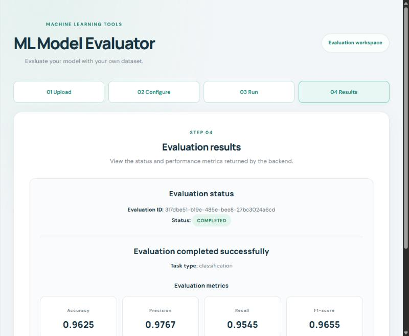
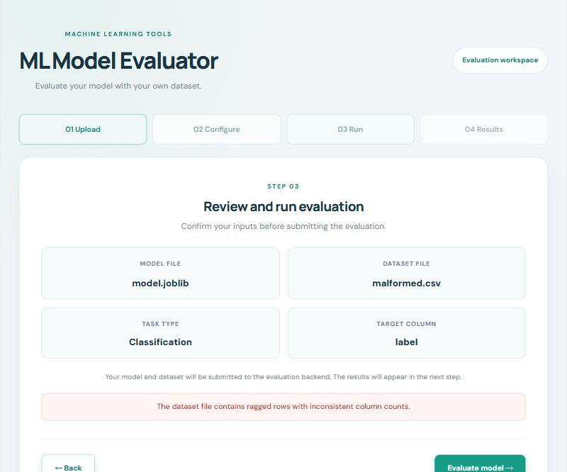
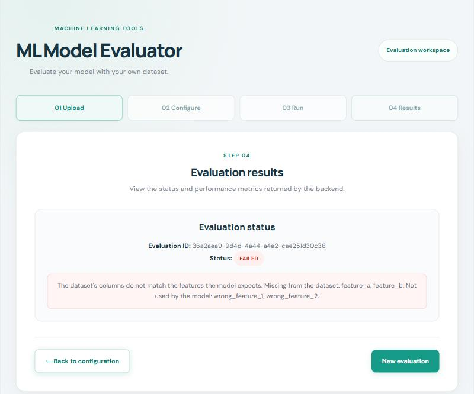
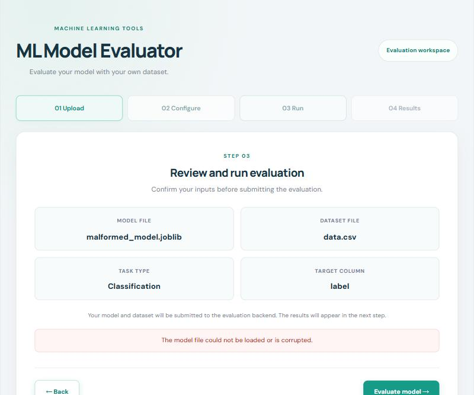

# Demo Script
## Web-Based ML Model Evaluator

A 5-minute walkthrough that shows the key requirements working: the main workflow (UC-01), a download (UC-03), an input rejection (UC-02), a failed evaluation, and a security rejection. Every step below was run against the real application, and `backend/scripts/demo_check.py` checks that all of them still behave this way before you start.

## 1. Who presents what

Proposed split, following who built each part. Change it if you like, but everyone should know their part before the rehearsal.

| Part | Time | Presenter |
|---|---|---|
| 0. Introduction | 0:00 – 0:30 | Adyanth |
| 1. Evaluate a model (UC-01) | 0:30 – 1:45 | Akshath (the interface) |
| 2. Download the result (UC-03) | 1:45 – 2:15 | Adyanth |
| 3. A rejected input (UC-02) | 2:15 – 2:55 | Akash |
| 4. A failed evaluation | 2:55 – 3:40 | Akshya |
| 5. A security rejection | 3:40 – 4:30 | Akash |
| 6. Wrap-up: tests and what is left | 4:30 – 5:00 | Adyanth |

## 2. Before the demo (10 minutes, the day before and again 15 minutes before)

**Clean start.** Results are kept in memory, so restarting the backend gives an empty application.

```bash
cd backend
pip install -r requirements-dev.txt
uvicorn app.main:app
```
In a second terminal:
```bash
cd frontend
npm install
npm run dev
```
Open http://localhost:5173 in a fresh browser window (not a private one: the page needs no login). Close other tabs.

**Check that it behaves as scripted.** In a third terminal:
```bash
cd backend
python scripts/demo_check.py
```
It must say `9 of 9 demo scenarios behave as scripted`. If not, fix that before anything else. Then restart the backend so the demo starts with no evaluations.

**Demo files** (all in `backend/tests/fixtures/`; on Windows the paths use `\`):

| Used for | Model | Dataset |
|---|---|---|
| Parts 1, 2 | `classification/model.joblib` | `classification/data.csv` |
| Part 3 | `classification/model.joblib` | `negative/malformed.csv` |
| Part 4 | `classification/model.joblib` | `negative/incompatible.csv` |
| Part 5 | `negative/malformed_model.joblib` | `classification/data.csv` |

Put a File Explorer window open at `backend/tests/fixtures/` so choosing files is quick.

**Backup.** The screenshots in [`planning/demo/`](demo/) show what each part looks like. If the live demo fails, show them and say so; do not switch the app to its mock mode, because that would show invented results.

## 3. The script

### Part 0 – Introduction (Adyanth, 30 s)
*Say:* "Our application evaluates a trained scikit-learn model against a CSV and reports standard metrics. You upload a model and a dataset, say whether it is classification or regression and which column to predict, and get the metrics back. The backend checks every input before running anything, and it runs the model in a separate, limited process."

### Part 1 – Evaluate a model (Akshath, 1 min 15 s) – UC-01
1. **Upload.** Choose `classification/model.joblib` and `classification/data.csv`. *Point out:* both files show with their sizes; the Next button was disabled until both were chosen.
2. **Configure.** Click *Next: Configure*. *Point out:* the page read the CSV header and lists the three columns (`feature_a, feature_b, label`). Pick **Classification** and target column **label**.
3. **Review.** Click *Next: Review*. *Say:* "A summary of what will be submitted." Click **Evaluate model**.
4. **Results.** Wait 2–5 seconds (the model runs in a separate process). *Expect:* status **COMPLETED**, task type classification, and four metric cards: **Accuracy 0.9625, Precision 0.9767, Recall 0.9545, F1-score 0.9655**.



*Say:* "These match the known values for this reference model, which our tests check automatically."

### Part 2 – Download the result (Adyanth, 30 s) – UC-03
Open http://127.0.0.1:8000/docs (the interactive API documentation). Open `GET /api/evaluations/{evaluation_id}/download`, click *Try it out*, paste the **Evaluation ID** from the results page, and *Execute*. *Expect:* `200` and a JSON result with the ID, task type, target column, filenames, metrics and timestamps; the response header says `attachment`.

*Say:* "The result downloads as a file. A result that isn't finished yet answers 409, and an unknown ID answers 404."

> **If the interface already has a Download button (US-17), use that instead** and say so. At the time of writing the button is not merged, so use the API page as above.

### Part 3 – A rejected input (Akash, 40 s) – UC-02
Click *New evaluation*. Choose `classification/model.joblib` and **`negative/malformed.csv`**, configure Classification / `label`, and run it. *Expect:* the page stays on the review step and shows **"The dataset file contains ragged rows with inconsistent column counts."**



*Say:* "The server checks the data before any model runs. Nothing was stored and no evaluation was created, and the message is plain language with no internal details."

### Part 4 – A failed evaluation (Akshya, 45 s)
Click *New evaluation*. Choose `classification/model.joblib` and **`negative/incompatible.csv`** (columns that don't match the model), Classification / `label`, and run it. *Expect:* status **FAILED** with **"The dataset's columns do not match the features the model expects. Missing from the dataset: feature_a, feature_b. Not used by the model: wrong_feature_1, wrong_feature_2."**



*Say:* "This input looked fine, so it was accepted, but it cannot work with this model. The evaluation fails with a specific reason that names the columns, and not a crash. A model that runs too long or uses too much memory is stopped the same way (time limit on every system; memory limit on Linux and macOS)."

### Part 5 – A security rejection (Akash, 50 s)
Click *New evaluation*. Choose **`negative/malformed_model.joblib`** and `classification/data.csv`, Classification / `label`, and run it. *Expect:* **"The model file could not be loaded or is corrupted."** on the review step.



*Say:* "A model file is a pickle, and pickles can run code when loaded. So uploaded models are only ever opened in a separate child process with a minimal environment and a timeout, and a corrupt one is rejected before the real evaluation starts."

If there is time, show two more rejections from a terminal (use `curl.exe` on Windows PowerShell), run from the repository root:
```bash
curl -s -X POST http://127.0.0.1:8000/api/evaluations -F model=@backend/tests/fixtures/negative/unsupported.txt -F dataset=@backend/tests/fixtures/classification/data.csv -F task_type=classification -F target_column=label
```
*Expect* `415 UNSUPPORTED_FILE_TYPE`. And a file named `../../evil.csv` is stored under a random name, so it cannot reach outside the storage folder.

### Part 6 – Wrap-up (Adyanth, 30 s)
*Say:* "We wrote a test report for all 25 test cases in the Test Plan: 22 pass. Two security cases fail because the features are not built yet: authentication, and deleting uploaded files after a retention period. They are recorded as defects with owners. One usability test with a new user is still to do."

Do not claim authentication, automatic cleanup of uploads, or a download button in the interface unless those have been merged and the report updated.

## 4. If something goes wrong

| What happens | What to do |
|---|---|
| The first evaluation takes longer than 5 s | Say "the model is loaded in a separate process"; it is normal for the first run on a cold machine. Wait. |
| Port 8000 is already in use | Close the old backend (`netstat -ano \| findstr :8000`, then `taskkill /PID <pid> /F` if it is yours) or start `uvicorn app.main:app --port 8001` and change the proxy line in `frontend/vite.config.js` temporarily (do not commit it). Do this *before* the demo. |
| The page shows "Could not reach the server" or `HTTP 502` | The backend is not running. Start it again; the page keeps your selections. |
| A result differs from this script | Stop, show the screenshots, and say so honestly. Then run `python scripts/demo_check.py` afterwards to find out why. |

## 5. Rehearsal record

The whole team rehearses once, with the script above and a stopwatch. Fill this in afterwards.

| Date | Who took part | Total time | Problems found and fixed |
|---|---|---|---|
| | | | |

Each person confirms they know their part: Adyanth ☐  Akash ☐  Akshath ☐  Akshya ☐
