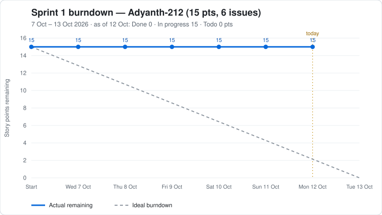

# Sprint Burndown



The chart shows **story points remaining** (the Estimate field in the [GitHub Project](https://github.com/orgs/SE-MiniProject-No25/projects/1)) at the end of each day of the sprint, against the ideal straight line to zero. Points only burn down when an issue is **Done**: closed, or its Status set to Done.

## Refresh the chart

After moving issues to In progress or Done on the board, regenerate it:

```bash
python3 planning/burndown/burndown.py                      # Sprint 1, Adyanth-212's issues
python3 planning/burndown/burndown.py --owner all          # whole team
python3 planning/burndown/burndown.py --sprint "Sprint 2"  # another sprint
```

Then commit the updated `.svg`. The script only needs Python 3 and the GitHub CLI logged in with the `project` permission (`gh auth refresh -h github.com -s project`).

## How a day is counted

- **Remaining on a day** = the sprint's total Estimate minus the Estimate of every issue done by the end of that day.
- **Done date** = the day the issue was closed; if it was moved to Done without being closed, the day its project card was last updated.
- Sprint dates and points are read from the project's Iteration and Estimate fields, so changing them there changes the chart.
- GitHub does not keep a history of status changes, so In progress is shown in the summary line under the title rather than as its own line.
