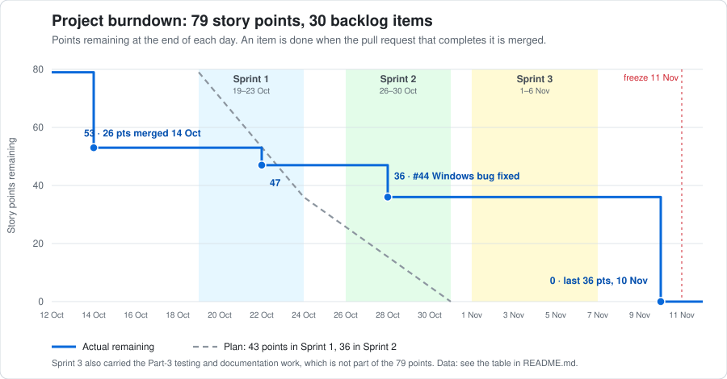

# Sprint Burndown



The chart shows the **story points still to do** (79 at the start) at the end of each day, against the plan in the [Sprint Plan](../Sprint_Plan.md): 43 points in Sprint 1 (19–23 Oct) and 36 in Sprint 2 (26–30 Oct). An item counts as done on the day the pull request that completes it was merged.

## What it shows

- **26 points were merged on 14 Oct**, before Sprint 1 began: the backend skeleton, the result service, the evaluation runner, the component check, the submit and status endpoints, and the three validation stories.
- **No backlog item was completed from 15 to 21 Oct.** Sprint 1 started on 19 Oct with 53 points left.
- **22 Oct:** the reference test fixtures and the classification metrics (6 points).
- **28 Oct:** the regression metrics and the interface stories (11 points). A Windows-only bug ([#44](https://github.com/SE-MiniProject-No25/Web-Based-ML-Model-Evaluator/pull/44): every valid model was rejected on Windows) had held up the metrics and interface work until then ([Deviation Log P-01](../../docs/Deviation_Log.md#2-process-deviations)).
- **10 Nov:** the remaining 36 points, which were Sprint 2's. The estimates did not allow for integration, so a third sprint (1–6 Nov, finished at the 11 Nov freeze) was declared for the spill-over and the Part-3 testing, which is not part of the 79 points.

## The data

Points are from the [Product Backlog](../Product_Backlog.md). The date is when the completing pull request was merged on GitHub (`gh pr view <number> --json mergedAt`). The interface stories US-12 to US-14 were completed by #45; #47 later combined it with a second interface.

| Item | Story | Owner | Points | Completed by | Merged |
|---|---|---|---|---|---|
| EN-01 | Project skeleton, tech stack and CI | Adyanth | 3 | [#31](https://github.com/SE-MiniProject-No25/Web-Based-ML-Model-Evaluator/pull/31) | 14 Oct |
| EN-04 | Enforce component separation (NFR-09) | Adyanth | 1 | [#33](https://github.com/SE-MiniProject-No25/Web-Based-ML-Model-Evaluator/pull/33) | 14 Oct |
| EN-05 | Result Service: store and retrieve evaluations | Adyanth | 2 | [#32](https://github.com/SE-MiniProject-No25/Web-Based-ML-Model-Evaluator/pull/32) | 14 Oct |
| EN-06 | Evaluation runner: load model, predict, hand off to metrics | Adyanth | 3 | [#34](https://github.com/SE-MiniProject-No25/Web-Based-ML-Model-Evaluator/pull/34) | 14 Oct |
| US-01 | Submit an evaluation (POST /api/evaluations) | Adyanth | 3 | [#35](https://github.com/SE-MiniProject-No25/Web-Based-ML-Model-Evaluator/pull/35) | 14 Oct |
| US-02 | Check status and results (GET /api/evaluations/{id}) | Adyanth | 3 | [#36](https://github.com/SE-MiniProject-No25/Web-Based-ML-Model-Evaluator/pull/36) | 14 Oct |
| US-06 | Reject unsupported and oversized files | Akash | 5 | [#38](https://github.com/SE-MiniProject-No25/Web-Based-ML-Model-Evaluator/pull/38) | 14 Oct |
| US-07 | Reject malformed datasets and models | Akash | 3 | [#39](https://github.com/SE-MiniProject-No25/Web-Based-ML-Model-Evaluator/pull/39) | 14 Oct |
| US-08 | Validate the evaluation configuration on the server | Akash | 3 | [#40](https://github.com/SE-MiniProject-No25/Web-Based-ML-Model-Evaluator/pull/40) | 14 Oct |
| EN-02 | Reference test fixtures (models + datasets with known metrics) | Akshya | 3 | [#41](https://github.com/SE-MiniProject-No25/Web-Based-ML-Model-Evaluator/pull/41) | 22 Oct |
| US-19 | Compute classification metrics | Akshya | 3 | [#42](https://github.com/SE-MiniProject-No25/Web-Based-ML-Model-Evaluator/pull/42) | 22 Oct |
| US-12 | Upload a model and dataset in the browser | Akshath | 3 | [#45](https://github.com/SE-MiniProject-No25/Web-Based-ML-Model-Evaluator/pull/45) | 28 Oct |
| US-13 | Configure the evaluation | Akshath | 3 | [#45](https://github.com/SE-MiniProject-No25/Web-Based-ML-Model-Evaluator/pull/45) | 28 Oct |
| US-14 | Run an evaluation and watch its status | Akshath | 3 | [#45](https://github.com/SE-MiniProject-No25/Web-Based-ML-Model-Evaluator/pull/45) | 28 Oct |
| US-20 | Compute regression metrics | Akshya | 2 | [#43](https://github.com/SE-MiniProject-No25/Web-Based-ML-Model-Evaluator/pull/43) | 28 Oct |
| EN-03 | Integration, full test run and Test Report | Adyanth | 2 | [#53](https://github.com/SE-MiniProject-No25/Web-Based-ML-Model-Evaluator/pull/53) | 10 Nov |
| EN-07 | API documentation that matches the Architecture contract | Adyanth | 2 | [#52](https://github.com/SE-MiniProject-No25/Web-Based-ML-Model-Evaluator/pull/52) | 10 Nov |
| EN-08 | Demo script and rehearsal | Adyanth | 1 | [#54](https://github.com/SE-MiniProject-No25/Web-Based-ML-Model-Evaluator/pull/54) | 10 Nov |
| US-03 | Download results (GET /api/evaluations/{id}/download) | Adyanth | 3 | [#48](https://github.com/SE-MiniProject-No25/Web-Based-ML-Model-Evaluator/pull/48) | 10 Nov |
| US-04 | Handle failed evaluations and resource limits | Adyanth | 5 | [#49](https://github.com/SE-MiniProject-No25/Web-Based-ML-Model-Evaluator/pull/49) | 10 Nov |
| US-05 | Meet the 2-second acknowledgement target | Adyanth | 2 | [#50](https://github.com/SE-MiniProject-No25/Web-Based-ML-Model-Evaluator/pull/50) | 10 Nov |
| US-09 | Safe, consistent error responses | Akash | 3 | [#56](https://github.com/SE-MiniProject-No25/Web-Based-ML-Model-Evaluator/pull/56) | 10 Nov |
| US-10 | Secure temporary storage and cleanup | Akash | 5 | [#57](https://github.com/SE-MiniProject-No25/Web-Based-ML-Model-Evaluator/pull/57) | 10 Nov |
| US-11 | Optional authentication for the API | Akash | 3 | [#58](https://github.com/SE-MiniProject-No25/Web-Based-ML-Model-Evaluator/pull/58) | 10 Nov |
| US-15 | View results as a table and chart | Akshath | 3 | [#59](https://github.com/SE-MiniProject-No25/Web-Based-ML-Model-Evaluator/pull/59) | 10 Nov |
| US-16 | Show validation and evaluation errors clearly | Akshath | 2 | [#61](https://github.com/SE-MiniProject-No25/Web-Based-ML-Model-Evaluator/pull/61) | 10 Nov |
| US-17 | Download results from the UI | Akshath | 1 | [#62](https://github.com/SE-MiniProject-No25/Web-Based-ML-Model-Evaluator/pull/62) | 10 Nov |
| US-18 | Make the workflow easy to follow | Akshath | 2 | [#65](https://github.com/SE-MiniProject-No25/Web-Based-ML-Model-Evaluator/pull/65) | 10 Nov |
| US-21 | Prove metrics are deterministic | Akshya | 1 | [#51](https://github.com/SE-MiniProject-No25/Web-Based-ML-Model-Evaluator/pull/51) | 10 Nov |
| US-22 | Run the usability test | Akshya | 1 | [#55](https://github.com/SE-MiniProject-No25/Web-Based-ML-Model-Evaluator/pull/55) | 10 Nov |

## Per-sprint charts from the board

`burndown.py` draws a chart for one sprint from the [GitHub Project](https://github.com/orgs/SE-MiniProject-No25/projects/1): the Estimate and Iteration fields and the date each issue was closed. It needs the GitHub CLI logged in with the `project` permission (`gh auth refresh -h github.com -s project`).

```bash
python3 planning/burndown/burndown.py --sprint "Sprint 1" --owner all
```

It uses the sprint dates stored in the project, so they have to match the [Sprint Plan](../Sprint_Plan.md) before the chart means anything.
